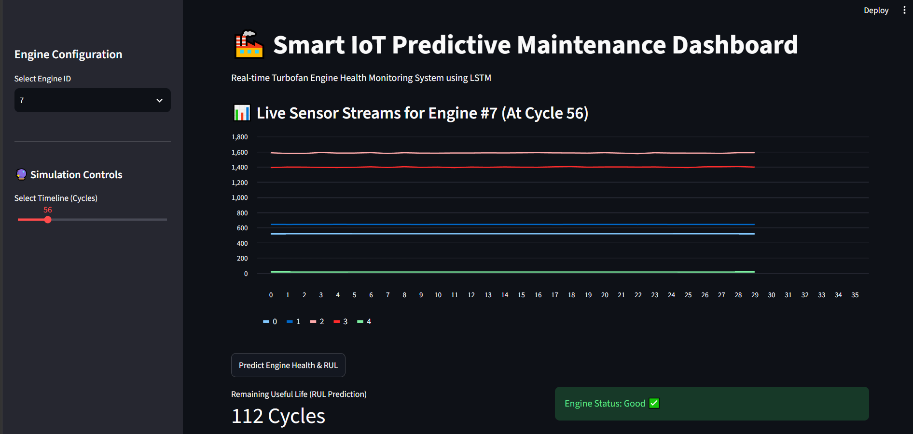

# 🏭 Smart IoT Predictive Maintenance System using LSTM

An end-to-end Deep Learning and MLOps project that predicts the **Remaining Useful Life (RUL)** of turbofan engines using NASA's CMAPSS dataset. The system features a robust **FastAPI backend** serving a PyTorch LSTM model and an interactive **Streamlit frontend dashboard** with real-time timeline simulation controls.

---

## 🚀 Key Features



* **Advanced RNN Architecture:** Built using **PyTorch LSTM (Long Short-Term Memory)** to effectively capture temporal dependencies in multi-sensor time-series IoT data.
* **Production-Grade Infrastructure:** Decoupled architecture with a high-performance **FastAPI REST API** serving model predictions.
* **Interactive Simulation Dashboard:** A **Streamlit** web app equipped with a **Timeline Slider** that allows users/recruiters to time-travel through an engine's degradation journey (from brand new to failure state).
* **Industrial Use-Case:** Solves a real-world business problem by preventing catastrophic failures and optimizing maintenance schedules in manufacturing and aviation sectors.

---

## 🛠️ System Architecture

[NASA CMAPSS Dataset] ➡️ [Data Preprocessing & Scaling] ➡️ [PyTorch LSTM Model]
│ (Saved as .pth)
▼
[Streamlit Frontend UI] ◀️ (Port 8501) ◀️ [FastAPI Backend REST API] (Port 8000)

---

## 📂 Project Directory Structure

```text
Predictive_Maintenance_IoT/
├── data/
│   ├── train_FD001.txt         # NASA Training Data
│   └── test_FD001.txt          # NASA Test Data
├── notebooks/
│   └── notebook.ipynb          # Exploratory Data Analysis & Model Training
├── model.py                    # PyTorch LSTM Model Class Architecture
├── api.py                      # FastAPI Web Server Integration
├── app.py                      # Streamlit Interactive Simulation Dashboard
├── scaler.pkl                  # Saved MinMaxScaler for input normalization
├── lstm_model.pth              # Trained Weights of the LSTM Model
└── requirements.txt            # Project Dependencies
```

---

## 💻 Tech Stack & Tools

* **Core Framework:** Python 3.12+
* **Deep Learning:** PyTorch
* **Data Processing:** Pandas, NumPy, Scikit-Learn
* **Backend Development:** FastAPI, Uvicorn, Pydantic
* **Frontend Dashboard:** Streamlit
* **Networking:** Requests

---

## 🏃 Implementation & Setup Guide

### 1. Clone the Repository & Setup Virtual Environment
```bash
git clone https://github.com<your-username>/Predictive_Maintenance_IoT.git
cd Predictive_Maintenance_IoT

python -m venv venv
# On Windows activate with:
venv\Scripts\activate
```

### 2. Install Project Dependencies
```bash
pip install -r requirements.txt
```

### 3. Execution Order (Concurrent Local Deployment)

To run this production-grade pipeline, you must execute the backend and frontend servers in **two separate terminal windows**:

* **Terminal Window 1: Fire up the FastAPI Backend Server**
  ```bash
  uvicorn api:app --reload
  ```
  *Ensures the model server is live at `http://127.0.0.1:8000`.*

* **Terminal Window 2: Launch the Interactive Streamlit UI**
  ```bash
  streamlit run app.py
  ```
  *Launches the web UI in your default browser at `http://localhost:8501`.*

---

## 📈 Evaluation Metrics & Results

The core LSTM model was optimized using the **Mean Squared Error (MSE)** loss function and Adam optimizer to track asset degradation patterns accurately over long cycles. 
* **Business Evaluation Logic:** The dashboard automatically translates predicted raw cycles into dynamic operational health statuses (**Good**, **Warning**, or **Critical**) based on safe flight-cycle limits.